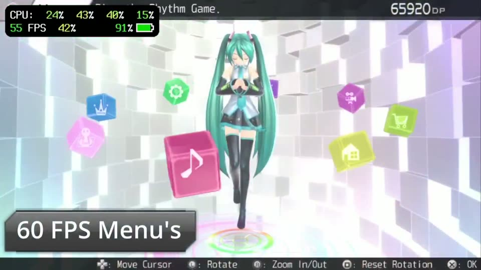

# Project DIVA F2nd 60 fps patch-er (PS Vita)

Makes Hatsune Miku: Project DIVA F2nd rut at 60 fps instead of 30.

Works with the EU (`PCSB00554`) and US (`PCSE00434`) versions. 

[](https://video.twimg.com/amplify_video/2125228221364862976/vid/avc1/1280x720/iC5j8_A2RqD8ucN2.mp4?tag=14)

## Install

1. Copy `f2nd60fps.suprx` to `ur0:tai/`
2. Add this to `ur0:tai/config.txt` (PCSB00554: EU) (PCSE00434: US)

   ```
   *PCSB00554
   ur0:tai/f2nd60fps.suprx
   ```
or

   ```
   *PCSE00434 
   ur0:tai/f2nd60fps.suprx
   ```

3. Reboot.

To actually hit a stable 60 i recommend to overclock your vita.

## Vita3K

1. Copy `vita3k/PCSB00554.txt` (EU) into Vita3K's `patch` folder
2. Restart the game.


## Hotkey

L + R + SELECT switches between 60 and 30 fps.

## Build

You need the [VitaSDK](https://vitasdk.org)

```
cd plugin
mkdir build && cd build
cmake .. && make
```

## License

GPL-3.0.
